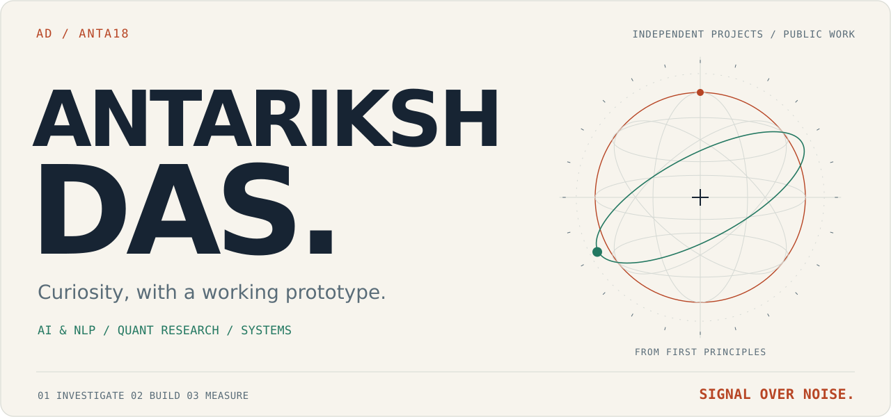
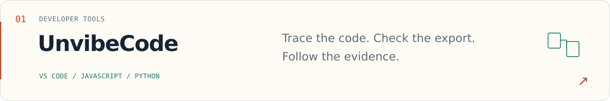
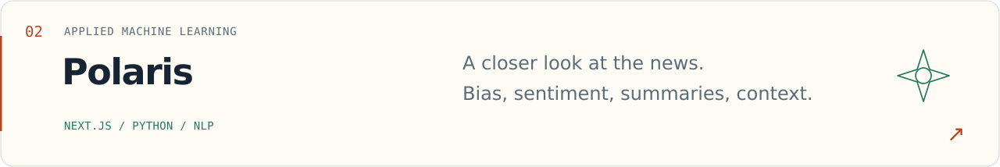
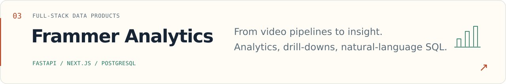
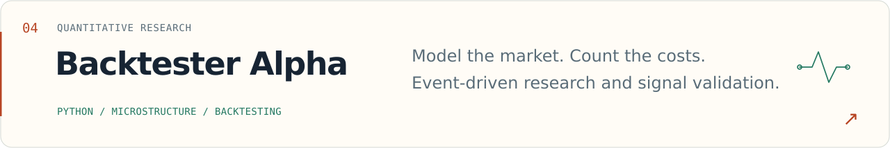
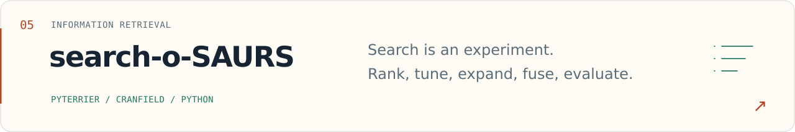
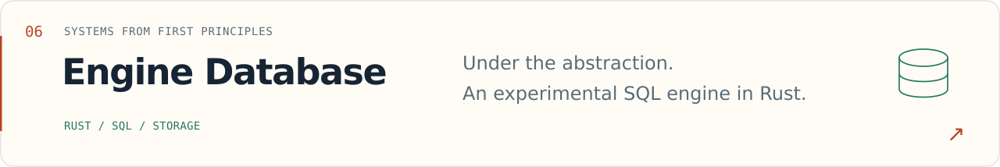
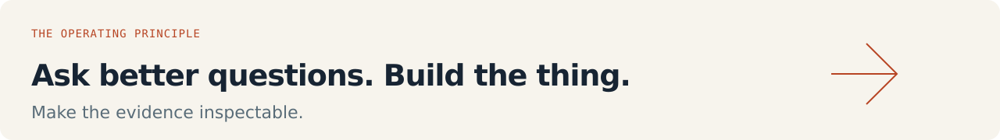

<picture>
  <source media="(max-width: 600px) and (prefers-color-scheme: dark)" srcset="assets/hero-mobile-dark.svg">
  <source media="(max-width: 600px) and (prefers-color-scheme: light)" srcset="assets/hero-mobile-light.svg">
  <source media="(prefers-color-scheme: dark)" srcset="assets/hero-dark.svg">
  
</picture>

### I like the part where an idea becomes a working system.

My projects move between developer tools, machine learning, quantitative research, and the machinery underneath software. The common thread: understand the problem, build something concrete, and leave a trail someone else can inspect.

**[Explore the repositories](https://github.com/Anta18?tab=repositories)** · **[Latest engineering investigation](https://github.com/Anta18/unvibecode-companion/blob/main/submission/START-HERE.md)**

 

### Selected work

<a href="https://github.com/Anta18/unvibecode-companion">
<picture>
  <source media="(max-width: 600px) and (prefers-color-scheme: dark)" srcset="assets/unvibecode-mobile-dark.svg">
  <source media="(max-width: 600px) and (prefers-color-scheme: light)" srcset="assets/unvibecode-mobile-light.svg">
  <source media="(prefers-color-scheme: dark)" srcset="assets/unvibecode-dark.svg">
  
</picture>
</a>

<a href="https://github.com/Anta18/polaris">
<picture>
  <source media="(max-width: 600px) and (prefers-color-scheme: dark)" srcset="assets/polaris-mobile-dark.svg">
  <source media="(max-width: 600px) and (prefers-color-scheme: light)" srcset="assets/polaris-mobile-light.svg">
  <source media="(prefers-color-scheme: dark)" srcset="assets/polaris-dark.svg">
  
</picture>
</a>

<a href="https://github.com/Anta18/frammerai-gc">
<picture>
  <source media="(max-width: 600px) and (prefers-color-scheme: dark)" srcset="assets/frammer-mobile-dark.svg">
  <source media="(max-width: 600px) and (prefers-color-scheme: light)" srcset="assets/frammer-mobile-light.svg">
  <source media="(prefers-color-scheme: dark)" srcset="assets/frammer-dark.svg">
  
</picture>
</a>

<a href="https://github.com/Anta18/Backtester_Alpha">
<picture>
  <source media="(max-width: 600px) and (prefers-color-scheme: dark)" srcset="assets/backtester-mobile-dark.svg">
  <source media="(max-width: 600px) and (prefers-color-scheme: light)" srcset="assets/backtester-mobile-light.svg">
  <source media="(prefers-color-scheme: dark)" srcset="assets/backtester-dark.svg">
  
</picture>
</a>

<a href="https://github.com/Anta18/Search-o-SAURS-A2">
<picture>
  <source media="(max-width: 600px) and (prefers-color-scheme: dark)" srcset="assets/search-mobile-dark.svg">
  <source media="(max-width: 600px) and (prefers-color-scheme: light)" srcset="assets/search-mobile-light.svg">
  <source media="(prefers-color-scheme: dark)" srcset="assets/search-dark.svg">
  
</picture>
</a>

<a href="https://github.com/Anta18/mydb">
<picture>
  <source media="(max-width: 600px) and (prefers-color-scheme: dark)" srcset="assets/database-mobile-dark.svg">
  <source media="(max-width: 600px) and (prefers-color-scheme: light)" srcset="assets/database-mobile-light.svg">
  <source media="(prefers-color-scheme: dark)" srcset="assets/database-dark.svg">
  
</picture>
</a>

<strong>The work, in plain text</strong>

- **[UnvibeCode Companion](https://github.com/Anta18/unvibecode-companion)** — Independent developer-tooling prototype: VS Code context tracing, offline export preflight, and reproducible engineering evidence.
- **[Polaris](https://github.com/Anta18/polaris)** — News-analysis prototype combining a Next.js interface with Python services for bias, sentiment, clickbait, and summarization.
- **[Frammer Analytics](https://github.com/Anta18/frammerai-gc)** — Full-stack video-pipeline analytics workspace with FastAPI, Next.js, PostgreSQL, drill-down dashboards, and natural-language SQL.
- **[Backtester Alpha](https://github.com/Anta18/Backtester_Alpha)** — Event-driven Python backtesting and research engine with market microstructure features, execution-cost models, and signal-validation tools.
- **[search-o-SAURS](https://github.com/Anta18/Search-o-SAURS-A2)** — Cranfield ranked-retrieval experiments with PyTerrier: preprocessing, model tuning, query expansion, proximity, fusion, and evaluation.
- **[Engine Database](https://github.com/Anta18/mydb)** — Experimental SQL database engine in Rust with an HTTP server, CLI shell, page storage, and write-ahead logging.

Also under the hood: an [ASP.NET Core workflow engine](https://github.com/Anta18/InfoneticaWorkflow), [pairs-trading experiments in C++](https://github.com/Anta18/Pairs-Trading), and [earlier web projects](https://github.com/Anta18?tab=repositories).

 

<picture>
  <source media="(max-width: 600px) and (prefers-color-scheme: dark)" srcset="assets/principles-mobile-dark.svg">
  <source media="(max-width: 600px) and (prefers-color-scheme: light)" srcset="assets/principles-mobile-light.svg">
  <source media="(prefers-color-scheme: dark)" srcset="assets/principles-dark.svg">
  
</picture>

Antariksh Das · <a href="https://github.com/Anta18?tab=repositories">Follow the code ↗</a>

